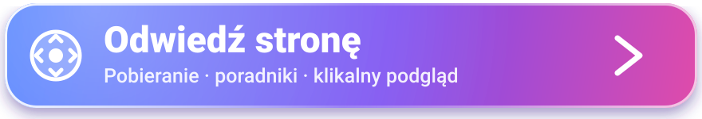
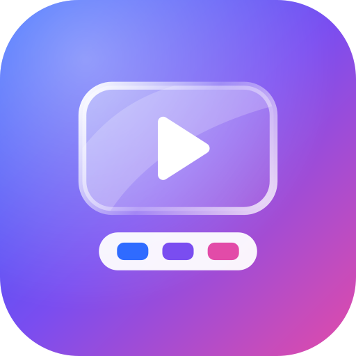
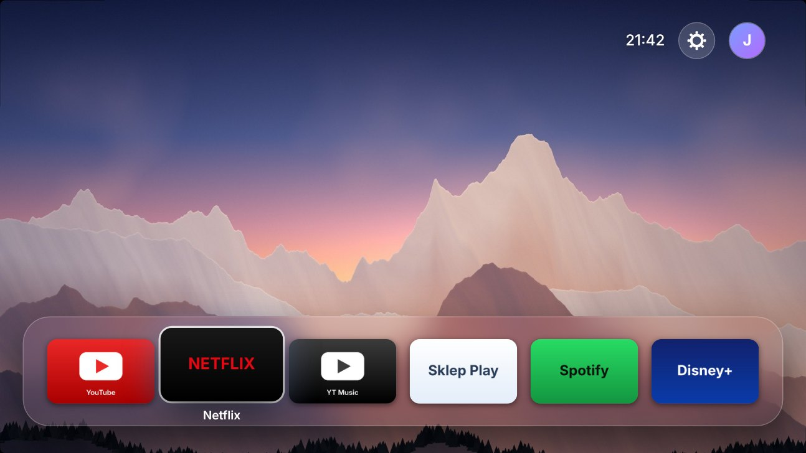
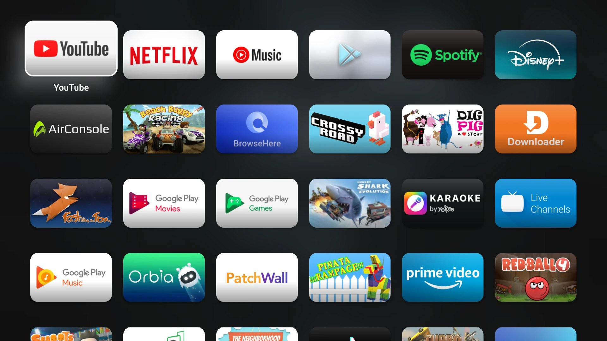
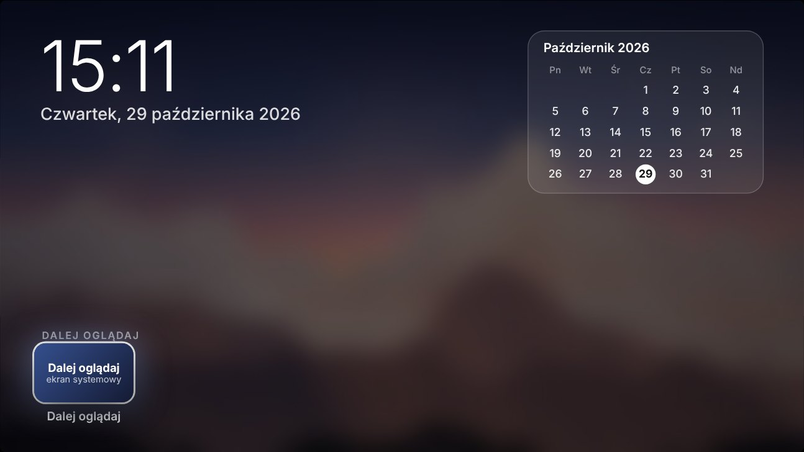
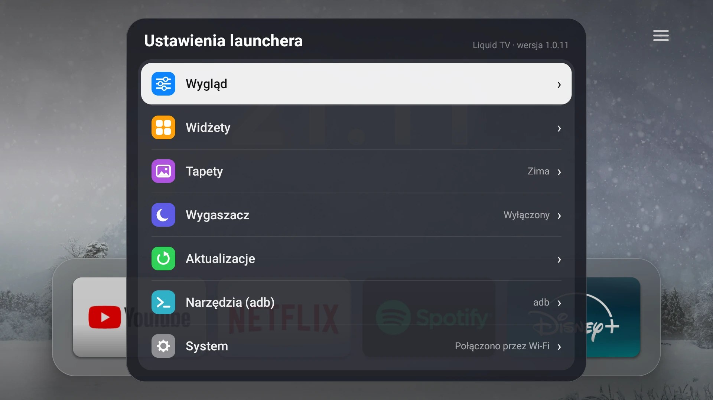
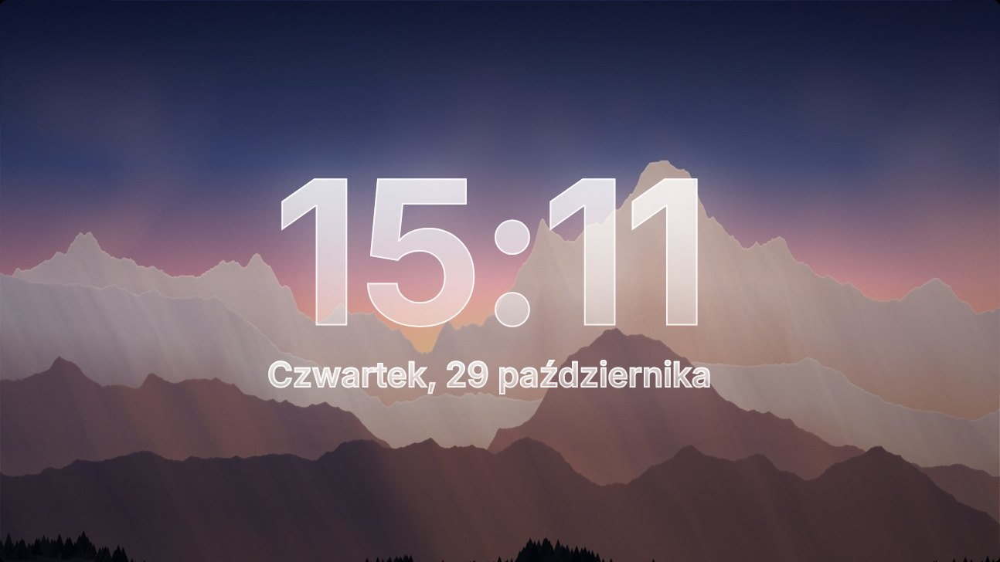

<p align="center">
  <a href="https://vcbgf5.github.io/LiquidLauncherMibox/"></a>
</p>

<p align="center">
  
</p>

# Liquid TV

Launcher na Android TV (Xiaomi Mi Box itp.) inspirowany ekranem głównym Apple TV.
Natywna aplikacja: Kotlin + Jetpack Compose, bez WebView.

Trzy osobne ekrany, jeden nad drugim:

1. **Widżety** (na górze) — strzałka w górę z ikon u góry ekranu głównego: duży zegar, pełna data i rząd widżetów:
   kalendarz miesiąca, najbliższe wydarzenia z Kalendarza Google, sieć (Wi-Fi, sygnał, adres IP), Bluetooth ze sparowanymi
   urządzeniami oraz pamięć i system. Które widżety są widoczne, wybierasz w Ustawieniach → Widżety. Strzałka w dół,
   **Wstecz** albo **Home** wraca.
2. **Ekran główny** (środek, tu się startuje) — zdjęcie na cały ekran, u góry zegar, ustawienia i konto Google,
   na dole sam dok z ulubionymi (zaokrąglony „szklany” panel z rozmytym tłem, do 6 aplikacji).
3. **Wszystkie aplikacje** (na dole) — strzałka w dół na doku przesuwa cały ekran w górę i wjeżdża pełnoekranowa siatka.
   Strzałka w górę z pierwszego rzędu, **Wstecz** albo **Home** wraca na ekran główny.

Ikona zębatki otwiera **ustawienia launchera**: przezroczystość docka i **rozmiar aplikacji na ekranie głównym**
(strzałki w lewo/prawo, zmiana widoczna od razu), tapety, wygaszacz, aktualizacje oraz przejście do **ustawień systemowych** Androida. Ikona obok pokazuje konto Google z urządzenia (pierwsza litera adresu).

**Rozmiar aplikacji** (70–140%) ma ograniczenie: dok nigdy nie wychodzi poza ekran. Przy sześciu ulubionych na ekranie
1080p domyślny rozmiar już wypełnia szerokość, więc większe wartości działają dopiero przy mniejszej liczbie ulubionych
(na przykład pięciu), a przy sześciu można je zmniejszać.

**Wygaszacz.** Po kilku minutach bez naciskania pilota (ustawienie „Wygaszacz po”: wyłączony, 1, 3, 5, 10, 15 lub 30 min,
domyślnie 3) na cały ekran wchodzi aktualna tapeta z bardzo powolnym zoomem, wielki zegar i data w „płynnym szkle”
(przezroczyste litery z poświatą i cienką krawędzią). Zegar powoli wędruje po ekranie, żeby nic nie wypalało się w jednym
miejscu. Dowolny przycisk budzi launcher (i nic poza tym nie robi). „Pokaż wygaszacz teraz” w ustawieniach pokazuje go od razu.
To samo jest zarejestrowane jako **systemowy wygaszacz Androida**: Ustawienia → Preferencje urządzenia → Wygaszacz ekranu →
**Liquid TV** (wtedy system sam go włącza po swoim czasie, także gdy launcher nie jest na wierzchu).


Animacje: płynne przejście między ekranami (zdjęcie „zostaje w tyle", rzędy aplikacji wjeżdżają kaskadą),
kafelki wchodzą jeden po drugim, zaznaczony kafelek unosi się, świeci i przebiega po nim połysk, wciśnięcie OK
lekko go „dociska", a otwierana aplikacja wyrasta z własnego kafelka na cały ekran (po powrocie zwija się z powrotem).
Zdjęcie bardzo powoli „oddycha".

**Kalendarz Google w widżecie.** Android TV zwykle nie ma własnego kalendarza, więc launcher czyta „Tajny adres w formacie
iCal” Twojego kalendarza Google (Kalendarz Google na komputerze → ustawienia kalendarza). Link wysyłasz na Boxa skryptem
`tools/tv_adb.py` (pozycja „Podłącz kalendarz Google”), a launcher odświeża go co 20 minut i pokazuje najbliższe dwa tygodnie,
także wydarzenia cykliczne. Rozumie typowe powtarzanie (codziennie, co tydzień z dniami, co miesiąc, co rok), ale nie wszystkie
egzotyczne reguły. Bez linku próbuje kalendarza systemowego, jeśli Box go ma i dałeś zgodę.

**Pogoda.** Widżet „Pogoda” pokazuje temperaturę, odczuwalną, wiatr, wilgotność i prognozę na kolejne dni (dane z Open-Meteo,
darmowe, bez klucza). Miasto wybierasz w Ustawieniach → Widżety (lista polskich miast), a dowolne inne ustawisz skryptem
`tools/tv_adb.py` („Ustaw miasto pogody”). Pogodę można też pokazać pod zegarem na ekranie głównym i na wygaszaczu.

**Zmiana ikony jednej aplikacji.** Przytrzymaj OK na aplikacji → „Zmień ikonę…”. W launcherze są trzy paczki ikon (Apple TV,
Liquid Glass, Minimal) dla 14 popularnych aplikacji; pojawiają się tam też paczki Nova/ADW zainstalowane na Boxie. Ikony paczek
wbudowanych rysuje `tools/make_tvos_tiles.py` z otwartych kształtów logo (Simple Icons, CC0); nazwy i logo należą do ich właścicieli.

**Głośność.** Pasek głośności Liquid TV (usługa dostępności) działa nad każdą aplikacją. Gdy poziom głośności Boxa okaże się prawdziwy (a nie sterowany przez telewizor), launcher
odbiera przyciski + i − i ustawia głośność sam przez adb (komenda `media volume --stream 3 --set N` bez `--show`, więc system
nie rysuje swojego paska); gdyby to nie działało, oddaje przyciski systemowi. Wcześniej sprawdza, co system zrobił
z poziomem: jeśli głośność zmieniła się o część skali (pilot, głośnik Bluetooth, wyjście z własną regulacją), pokazuje prawdziwy
poziom, a jeśli Box poziomu nie widzi (telewizor steruje głośnością przez HDMI-CEC), pokazuje kierunek ▲ ▼. Tryby: wyłączony;
„systemowy zostaje”; „systemowy ukryty” (domyślny): pasek Androida jest zamykany kilkukrotnie zaraz po naciśnięciu, więc widać
głównie nasz. Tryb przełączysz w Szybkich ustawieniach. Gdy głośność nie działa: Ustawienia → System → „Diagnostyka głośności”
pokazuje, jakie przyciski dochodzą z pilota, czy zmiany głośności są wykrywane i dokąd idzie dźwięk; „Okna systemowe i audio (adb)”
pokazuje, które okno Androida jest paskiem głośności. Skrypt `tools/tv_adb.py` ma tę samą diagnostykę z komputera.

**Przycisk Menu.** Przycisk Menu (oraz Settings i Contents Menu) otwiera szybkie ustawienia. Jeśli pilot wysyła inny kod, albo system
go nie przepuszcza: Ustawienia → System → „Przycisk szybkich ustawień”, naciśnij wybrany przycisk, a launcher go zapamięta.
Z włączoną usługą dostępności działa on w każdej aplikacji.

**Pilot z gładzikiem.** Część pilotów (w tym niektóre łączone z Mi Boksem) ma mały touchpad i zgłasza przesunięcia
jako dotyk, nie jako strzałki. Launcher to rozpoznaje: przesunięcie w górę/dół działa jak strzałka góra/dół (zmiana
ekranu), w lewo/prawo na siatce aplikacji przesuwa fokus o jeden-dwa kafelki, a stuknięcie w gładzik działa jak OK.
Piloty bez gładzika działają zupełnie tak samo jak dotąd.

**Uprawnienia.** Skrypt `tools/tv_adb.py` ma pozycję „Nadaj launcherowi uprawnienia”: zmiana ustawień systemowych (usługa
dostępności włącza się wtedy sama z ustawień), sparowane urządzenia Bluetooth, kalendarz, rysowanie nad aplikacjami i praca w tle.
Czego Android nie pozwala nadać żadnej zwykłej aplikacji, to uprawnień „systemowych” (podpis producenta): fabryczny launcher je
ma, bo jest częścią systemu, a Liquid TV nie. Dotyczy to m.in. list „Dalej oglądaj” innych aplikacji i wyłączania Boxa.
Dlatego tej listy w launcherze już nie ma.

**Szybkie ustawienia.** Przytrzymaj OK na zębatce (albo naciśnij Menu na pilocie): kafelki z Wi-Fi, Bluetooth, dźwiękiem,
wygaszaczem, trybem wydajności, zwolnieniem pamięci, uśpieniem, restartem, włączaniem telewizora (HDMI-CEC), pilotem z telefonu i ustawieniami.

**Narzędzia przez adb** (Ustawienia → Narzędzia): jednoklikowa konfiguracja (uprawnienia, usługa dostępności, dostęp do powiadomień,
ciche aktualizacje), zwolnienie pamięci (zatrzymuje aplikacje w tle i czyści cache), szybsze animacje systemu (0,5× lub wyłączone),
wyłączanie aplikacji (np. fabrycznych; z potwierdzeniem i listą do przywrócenia; wyłączenie fabrycznego ekranu głównego sprawia,
że przycisk Home otwiera Liquid TV), uśpienie, restart i wyłączenie Boxa, włączanie i przełączanie telewizora przez HDMI-CEC
(zależy od telewizora i jego ustawień CEC), a w menu aplikacji „Wymuś zatrzymanie”.

**Foldery.** Przytrzymaj OK na aplikacji → „Dodaj do folderu” (Streaming, Gry, Muzyka, Narzędzia, Dla dzieci, Inne). Foldery
są pierwsze na liście wszystkich aplikacji; aplikacja w folderze znika z głównej siatki.

**Pilot z telefonu.** Ustawienia → Narzędzia → „Pilot z telefonu”: kod QR z adresem strony działającej w launcherze (ta sama sieć
Wi-Fi). Na telefonie: pilot (strzałki, OK, wstecz, home), głośność, uśpienie/restart, pola na link kalendarza Google, miasto
pogody i adres do otwarcia na TV, a także **wysyłanie własnych zdjęć na tapetę** (kategoria „Moje zdjęcia”, do 60 zdjęć po 25 MB). W adresie jest sekret; „Nowy link” unieważnia stary. Strona działa tylko przy otwartym oknie,
chyba że włączysz „działa cały czas”. W zakładce **Box** telefon sam wyszukuje Boksy w sieci (NSD/mDNS) i pokazuje je
na liście — znany Box (taki, z którym telefon już się łączył) wybiera się jednym dotknięciem, a nowy trzeba najpierw
podpiąć kodem QR, bo sam adres bez sekretu nic nie daje.

**Animowana tapeta (wideo).** W tej samej zakładce (Zdjęcia) możesz zamiast tego wysłać krótki klip wideo (limit 25 MB, nie jest
skracany — wybierz sam coś krótkiego): zapętla się bez dźwięku w tle ekranu głównego. Pierwsza klatka klipu służy jako zwykłe
zdjęcie wszędzie indziej (rozmyte tło okien, wygaszacz), więc reszta launchera działa bez zmian. Można to wyłączyć w Ustawieniach
(Wygląd → Animowana tapeta) albo przyciskiem na telefonie. Niedostępne w wersji Lite i w trybie oszczędnym — dekodowanie wideo
cały czas jest zbyt dużym obciążeniem dla słabego Boksa.

**Teraz gra.** Widżet pokazuje utwór, wykonawcę, okładkę i postęp z aplikacji muzycznych i wideo (Spotify, YouTube Music itd.);
OK = odtwórz/pauza, przytrzymanie OK = następny utwór. Wymaga dostępu do powiadomień (nadawany przyciskiem w Narzędziach
albo w ustawieniach Androida).

**Pasek u góry.** Ustawienia → Wygląd → „Pasek u góry”: „Ikony” (rząd okrągłych przycisków: Wi-Fi, Bluetooth, ustawienia, konto) albo
„Minimalny”: jedna ikona z trzema kreskami, której kliknięcie rozwija listę (Wi-Fi, Bluetooth, Konto, Szybkie ustawienia, Ustawienia)
z aktualnym stanem sieci, Bluetooth i konta; Wstecz zwija listę.

**Wygląd i wydajność.** Kafelki pochylają się w stronę, z której przyszedł fokus, a grafika przesuwa się za ramką; tapeta
lekko przesuwa się przy przechodzeniu po doku; kolor akcentu i odcień szkła okien (Ustawienia → Wygląd); na jasnych zdjęciach
góra i dół są automatycznie przyciemniane, żeby zegar i nazwy aplikacji były czytelne. **Styl okien: Liquid Glass** (Ustawienia → Wygląd → Styl okien i paneli): okna, szybkie ustawienia i menu są szkłem z rozmytą,
bardziej kolorową tapetą pod spodem, załamaniem światła przy brzegu, jasną krawędzią i delikatną poświatą (na jasnej tapecie
szkło ciemnieje, żeby tekst był czytelny); można wrócić do prostego, ciemnego szkła. **Tryb wydajności** (automatyczny /
zawsze oszczędnie / pełne efekty): w oszczędnym nie ma oddychającej tapety, błysków, pochylania ani płynnego przenikania tapet,
tapeta jest mniejsza, a cienie lżejsze; automatyczny włącza go sam, gdy urządzenie jest słabe albo gdy zmierzone klatki
launchera stale się spóźniają. Po powrocie z aplikacji fokus wraca na kafelek, z którego ją uruchomiono.

**Tapety z Unsplash.** Launcher zmienia tapetę co kilka minut (z płynnym przenikaniem), losując z wybranych kategorii:
zwierzęta, góry, miasto, las, ocean, kosmos, zima, niebo, abstrakcja, minimalizm, jeziora, pustynia, jesień, kwiaty,
wodospady, architektura, tropiki, neon i miasto nocą, łąki i pola. Kategorie wybierasz w ustawieniach launchera
(zębatka → Wygląd → Tapety): otwiera się lista z zaznaczaniem, można wybrać kilka naraz, albo „Wszystkie”/„Żadna”.
Częstotliwość, „Następna tapeta” i imię autora zdjęcia są tam samo.
Zdjęcia leżą w folderze [`wallpapers/`](wallpapers/) tego repozytorium i są stamtąd pobierane — jak je tam wgrać
(klucz Unsplash, jedno kliknięcie w Actions), opisuje [`wallpapers/README.md`](wallpapers/README.md).
Dopóki zdjęć nie ma, działa wbudowana tapeta.

Domyślne ulubione i zawsze pierwsze w siatce: YouTube, Netflix, YouTube Music, Sklep Play, Spotify, Disney+.

- **Kafelki** jak w tvOS: szerokie prostokąty 5:3 (banner aplikacji TV, a dla zwykłych aplikacji ikona na kolorowym tle), po najechaniu unoszą się, rosną i świecą.
- **Przytrzymaj OK** na aplikacji → menu: dodaj/usuń z ulubionych, przesuń w lewo/prawo, informacje o aplikacji, odinstaluj.

## Podgląd







**Klikalny podgląd w przeglądarce: https://vcbgf5.github.io/LiquidLauncherMibox/preview.html**

Podgląd odtwarza aktualny wygląd (wersja i „Co nowego” są takie jak w wydaniu): ekran główny z dużym szklanym zegarem
i minimalnym paskiem (☰ rozwija Wi-Fi, Bluetooth, konto, szybkie ustawienia, ustawienia), strona widżetów nad nim
(kalendarz, pogoda, „Teraz gra”, sieć, Bluetooth, pamięć), wszystkie aplikacje z folderem, menu aplikacji (przytrzymaj
OK albo prawy przycisk myszy), **szybkie ustawienia** (przycisk Menu / `M`), pasek głośności (`+` i `-`), ustawienia
w kategoriach (kolor akcentu, odcień szkła, pasek u góry, zegar, paralaksa, tryb wydajności, widżety, tapety,
wygaszacz, aktualizacje, narzędzia adb, system), kod QR pilota z telefonu i wygaszacz. Zmiany ustawień działają na
żywo i zostają w przeglądarce.

Sterowanie: strzałki, Enter (przytrzymaj = menu aplikacji), Esc (Wstecz), `H` (Home), `M` (szybkie ustawienia),
`+`/`-` (głośność), `S` (wygaszacz), kółko myszy (góra/dół); albo wirtualny pilot pod ekranem. Najechanie myszą
przesuwa zaznaczenie jak wskaźnik pilota Magic Remote, kliknięcie otwiera. Działa też na telefonie. Parametry
adresu: `?s=settings`, `?s=quick`, `?s=apps`, `?s=info`, `?s=saver` otwierają dany ekran, `?embed` ukrywa pilota,
`?lite` włącza tryb oszczędny.

Zdjęcia powyżej to prawdziwe zrzuty ekranu z Mi Box S (kafelki w podglądzie są z nich wycięte). Podgląd to
makieta: dane (pogoda, wydarzenia, sparowane urządzenia) są przykładowe, a przyciski adb tylko pokazują, co by się stało.

Źródło podglądu: [`preview/src/`](preview/src/) (strona `preview.html`, obrazy w `assets/`). Gotowy plik
(`preview/preview.html`, ten sam trafia do paczki webOS) powstaje poleceniem `python3 tools/build_preview.py`;
wersja i „Co nowego” są brane z `preview/src/version.txt` i `Changelog.kt`.

## Spotify

Jak podłączyć własne konto:

1. Potrzebne: konto **Spotify Premium** i aplikacja **Spotify** na Boxie (musi działać, żeby Box był widoczny dla Spotify jako
   urządzenie; launcher sam ją uruchomi, gdy trzeba).
2. W aplikacji **Liquid TV Pilot** na telefonie otwórz zakładkę **Spotify** i wybierz **Połącz ze Spotify**. Zaloguj się na
   stronie Spotify (bez wpisywania hasła w samej aplikacji) i zatwierdź — aplikacja wróci sama.
3. Jeśli telefon jest połączony z Boxem (zakładka Box), logowanie od razu trafia do launchera.
4. Na telewizorze: strzałka w górę z ekranu głównego → karta **Spotify**. **OK** to pauza lub wznowienie bez otwierania
   odtwarzacza; **przytrzymanie OK** otwiera pełnoekranowy odtwarzacz (okładka, pasek postępu, playlisty i utwory — OK na
   playliście pokazuje jej utwory, na utworze go odtwarza, Wstecz cofa). Telefon w zakładce Spotify też steruje muzyką.
   Przyciskiem **Tekst** przełączysz prawą stronę na tekst piosenki (z lrclib.net) — podświetla aktualną linijkę, gdy
   jest dostępny zsynchronizowany tekst, albo pokazuje go jako zwykły, przewijany blok.
5. Logowanie jest jednorazowe: potem telefon możesz odłożyć albo wyłączyć — launcher na Boksie pamięta sesję i sam rozmawia ze
   Spotify (sam odświeża token), więc muzyka gra i steruje się nią samym pilotem telewizora, bez telefonu w pobliżu.

**Jednorazowa konfiguracja projektu** (właściciel): na [developer.spotify.com](https://developer.spotify.com/dashboard) utwórz aplikację,
w *Redirect URIs* dodaj dokładnie `liquidtvpilot://spotify-callback`, a **Client ID** wpisz w GitHubie jako sekret Actions
`CLIENT_ID_SPOTIFY` (Settings → Secrets and variables → Actions). Buildy wkładają go do aplikacji na telefon. **Client Secret nie jest
potrzebny** (logowanie PKCE) i nie wolno go wkładać do aplikacji ani repozytorium. Aplikacja Spotify w trybie deweloperskim działa dla
właściciela (Premium) i kilku użytkowników dodanych w *User Management*; utwory pokazuje tylko dla własnych playlist (cudze odtworzysz w całości).
Bez sekretu aplikacja Pilot pozwala wpisać Client ID ręcznie.

## Last.fm

Scrobbluje to, co gra przez Spotify na Boksie, na Twoje konto Last.fm — bez tego nic dodatkowego nie trzeba instalować.

1. W aplikacji **Liquid TV Pilot** na telefonie otwórz zakładkę **Spotify** (karta **Last.fm** jest niżej, pod Spotify) i wpisz swoją
   **nazwę użytkownika** i **hasło** do Last.fm, potem **Połącz z Last.fm**. Logowanie dzieje się od razu na telefonie (tzw. „sesja
   mobilna” Last.fm) — na launcher trafia tylko klucz sesji, nigdy samo hasło.
2. Jeśli telefon jest połączony z Boxem (zakładka Box), klucz sesji od razu trafia do launchera.
3. Od tej pory launcher sam scrobbluje to, co gra przez Spotify: „teraz gra” wysyła od razu, a utwór liczy się jako odsłuchany (i
   trafia na profil) po połowie swojej długości albo 4 minutach, zależnie co krótsze — tak jak robią to oficjalne aplikacje Last.fm.
4. Włącznik i rozłączenie: na telewizorze, zębatka → **Widżety** (przewiń niżej, pod widżetami i kalendarzem).

**Jednorazowa konfiguracja projektu** (właściciel): załóż konto API na [last.fm/api/account/create](https://www.last.fm/api/account/create)
(wystarczy zwykłe konto Last.fm) — dostaniesz **API Key** i **Shared Secret**. Wpisz je w GitHubie jako dwa sekrety Actions,
`LASTFM_API_KEY` i `LASTFM_API_SECRET` (Settings → Secrets and variables → Actions); buildy wkładają je do obu aplikacji (podpisane
wywołania Last.fm, nawet samo logowanie, potrzebują i klucza, i sekretu — inaczej niż logowanie PKCE Spotify). Bez obu sekretów karta
Last.fm w aplikacji Pilot poinformuje, że ta kompilacja nie ma klucza API.

## Aplikacja na telefon: Liquid TV Pilot

W każdym wydaniu jest drugi plik, `LiquidTVPilot.apk` (aplikacja na telefon z Androidem 8+):
**pilot** (strzałki, OK, Wstecz, Home, głośność, uśpienie, włączenie telewizora), **sterowanie głosem** (powiedz np.
„głośniej”, „następny” albo „do góry” zamiast szukać przycisku), **wpisywanie tekstu** na TV i
**otwieranie adresu** na TV, **wysyłanie zdjęć jako tapet** (zmniejszane i obracane do pionu), **udostępnianie ekranu
telefonu** na telewizorze (obraz bez dźwięku, kilka klatek na sekundę; na TV przycisk Wstecz kończy) oraz **kursor
myszy przechyleniem telefonu** (zakładka Pilot → „Otwórz touchpad”): żyroskop rusza kropką po ekranie TV, dotknięcie
ekranu telefonu klika w jej miejscu. Pozycja „Udostępnij”
w galerii i przeglądarce też tu trafia: zdjęcie staje się tapetą, link otwiera się na TV, a inny tekst jest wpisywany w
zaznaczone na TV pole. Połączenie: na TV Ustawienia → Narzędzia (adb) → Pilot z telefonu, w aplikacji zakładka Box →
„Skanuj kod QR” albo „Szukaj w sieci” (automatyczne wykrywanie Boksów, przełączanie między kilkoma jednym dotknięciem).
Telefon i Box muszą być w tej samej sieci. Wpisywanie tekstu, pilot poza launcherem i kliknięcia
touchpada wymagają skonfigurowanego adb (Ustawienia → Narzędzia → Skonfiguruj adb); `input text` zna tylko znaki ASCII.
Filmy i muzykę z telefonu najlepiej wysyłać wbudowanym Chromecastem Mi Box S.

## LG webOS

Launcher jest natywny dla Androida i nie uruchomi się na webOS, ale folder [`webos/`](webos/) pakuje klikalny podgląd
(makietę wyglądu) jako aplikację dla telewizorów LG, do testów: instrukcja w [`webos/README.md`](webos/README.md).

## Aktualizacje w aplikacji

Gdy launcher jest na ekranie, **sam sprawdza co 5 sekund** (do zmiany: 5 s, 30 s, 5 min, 1 godz.; Ustawienia → Aktualizacje),
czy w najnowszym wydaniu jest nowsza wersja. To jedno malutkie zapytanie; gdy się nie uda (brak internetu, GitHub odmawia),
odstępy rosną do 5 minut, żeby nie zasypywać serwera. Nowa wersja instaluje się, gdy przez chwilę nie dotykasz pilota.
Tę samą wersję launcher proponuje samoczynnie tylko raz (nieudaną cichą instalację ponawia po kwadransie), a przy zębatce
świeci czerwona kropka, gdy nowa wersja czeka.

**Ciche aktualizacje (bez okna Androida)** działają przez adb na samym Boxie. Jednorazowo: włącz debugowanie w Opcjach
programisty, wejdź w Ustawienia → **Narzędzia (adb)** → **Skonfiguruj adb**, a na telewizorze zaznacz „Zawsze zezwalaj”.
Instalacja wykonuje się w osobnej powłoce na Boxie (przeżywa restart launchera) i sama uruchamia launcher po zakończeniu;
jeśli coś nie pójdzie, Ustawienia → Aktualizacje → **Diagnostyka adb** pokazuje krok po kroku, co zawiodło. Wymaga Androida 8+.
Po aktualizacji pokazuje się okno **Co nowego** (ponownie: Ustawienia → Aktualizacje).

W ustawieniach launchera (zębatka): **Sprawdź aktualizacje**, **Aktualizuj teraz**, przełącznik **Aktualizuj automatycznie**
i **Ciche aktualizacje**. Bez adb system zapyta o zgodę na „instalowanie nieznanych aplikacji” i pokaże własne okno instalacji.

**Żeby aktualizacje „na wierzchu” w ogóle działały, wersje muszą być podpisane tym samym kluczem.** Jednorazowo:

1. Repo → **Settings → Secrets and variables → Actions → New repository secret**: nazwa `KEYSTORE_PASSPHRASE`,
   wartość: długie losowe hasło (min. 30 znaków; to ono chroni klucz, więc nie wymyślaj krótkiego).
2. Zbuduj wydanie (np. nowy release `v1.0.2`). Workflow sam utworzy klucz i zapisze go w repo **zaszyfrowanego**
   hasłem z sekretu (`signing/release.p12.enc`) — bez hasła jest bezużyteczny.
3. **Ostatni raz odinstaluj starą wersję** (była podpisana innym kluczem) i zainstaluj nową ręcznie.
   Od tej chwili każda kolejna wersja zainstaluje się na poprzedniej przez „Aktualizuj teraz”.

Nie usuwaj ani nie zmieniaj sekretu `KEYSTORE_PASSPHRASE` — bez niego nie da się podpisać następnych wersji
tym samym kluczem i trzeba zaczynać od nowa (z odinstalowaniem).

### Kanał beta (tylko dla zaproszonych)

Wydanie, którego tag zawiera `beta` (np. `v1.0.18-beta1`), GitHub oznacza jako **prerelease**. Taka wersja:

- **nie** pojawia się na stronie pobierania ani w jej liście wydań,
- **nie** jest proponowana przez auto-aktualizator w launcherze (sprawdza tylko „latest”, co u GitHuba z definicji
  pomija prerelease),
- jest widoczna tylko na stronie **Releases** repozytorium i pod bezpośrednim linkiem do `LiquidTV.apk`/`LiquidTVLite.apk`
  tego konkretnego wydania.

Czyli dostęp jest czysto ręczny: zbuduj wydanie beta (workflow `Build APK` → `Run workflow`, pole `tag` np. `v1.0.18-beta1`)
i wyślij link do APK zaufanej osobie sam, dowolnym kanałem. Nie ma żadnego kodu ani logowania sprawdzanego przez aplikację.

## Połączenie z Boxem przez ADB (skrypt na komputer)

[`tools/tv_adb.py`](tools/tv_adb.py) łączy się z Boxem przez sieć (domyślnie port 5555) i ma menu najczęstszych czynności:
instalacja i aktualizacja Liquid TV z GitHuba (większość tego umie już sam launcher: Ustawienia → Narzędzia), włączenie usługi dostępności (pasek głośności, okno zasilania),
ustawienie domyślnego ekranu głównego, wpisanie linku w zaznaczone pole, zrzut ekranu (zapisuje w Obrazach lub na Pulpicie),
uśpienie i obudzenie Boxa, **podgląd ekranu Boxa na żywo** (`--live`: scrcpy, który skrypt potrafi pobrać na Windowsie, a gdy go nie
ma, okno odświeżane około raz na sekundę, sterowane strzałkami, Enterem, Esc, H oraz + i −), **własna komenda** (dowolna komenda `adb shell`, a zaczynając od `adb ` zwykłe polecenie adb; albo
jednorazowo `--shell "komenda"`) oraz **„Nadaj WSZYSTKIE uprawnienia”** (`--grant-all`): każde uprawnienie zadeklarowane w aplikacji
(także te, których launcher nie używa; są wpisane w manifeście tylko po to, żeby dało się je nadać), operacje appops, praca w tle,
dostęp do powiadomień i usługa dostępności, z podsumowaniem tego, czego Android nie pozwala nadać zwykłej aplikacji.
Potrzebuje tylko Pythona 3; jeśli nie ma `adb`, zaproponuje pobranie go od Google.

```bash
python tools/tv_adb.py 192.168.1.50
```

Najpierw na Boxie włącz Opcje programisty (7 razy „Kompilacja” w Informacjach) i debugowanie, a przy pierwszym połączeniu
potwierdź pytanie na ekranie telewizora.

## Pobranie APK

- Strona z pobieraniem i poradnikami (instalacja, adb, tv_adb.py, pilot na telefon): **https://vcbgf5.github.io/LiquidLauncherMibox/** — źródło w `site/`, publikowane automatycznie workflow „Site” po zmianie plików w `site/`, `preview/` lub `docs/`
- Krótki adres do wpisania pilotem (od razu pobiera najnowszą wersję): **vcbgf5.github.io/LiquidLauncherMibox/apk**
- Bezpośredni link: `https://github.com/vcbgf5/LiquidLauncherMibox/releases/latest/download/LiquidTV.apk`
- **Wersja Lite** (stare telewizory z ok. 0,5 GB RAM): `https://github.com/vcbgf5/LiquidLauncherMibox/releases/latest/download/LiquidTVLite.apk`
  albo krótki adres **vcbgf5.github.io/LiquidLauncherMibox/apk/lite**. Opis niżej.

### Dwie wersje: zwykła i Lite

Każde wydanie ma dwa pliki z launcherem, `LiquidTV.apk` i `LiquidTVLite.apk`. To ta sama aplikacja (ta sama nazwa
pakietu i klucz), więc jedna zastępuje drugą i możesz wybrać tę, która pasuje do telewizora. **Lite** jest dla starych
telewizorów z ok. 0,5 GB RAM:

- tapeta w pamięci jest dwa razy mniejsza w każdym wymiarze i zajmuje dwa bajty na piksel zamiast czterech, wbudowane tło
  też; kafelki aplikacji i ikony mają ok. jedną trzecią zwykłej pamięci,
- od początku działa tryb oszczędny (bez efektów, pochylania kafelków i płynnego przenikania tapet) i proste ciemne szkło
  w oknach zamiast Liquid Glass (oba da się zmienić w Ustawieniach → Wygląd),
- aktualizuje się z własnego pliku (`LiquidTVLite.apk`), więc nie przeskakuje na zwykłą wersję. W Ustawieniach numer
  wersji ma dopisek „Lite”.

Wymaga tego samego Androida co zwykła wersja (6.0 i nowszy). Skrypt `tv_adb.py` sam podpowiada Lite, gdy Box ma mniej niż
ok. 0,9 GB RAM (`--install --lite` wybiera ją bez pytania).

Nowe wydanie: utwórz release z tagiem (np. `v1.1.0`) na GitHubie albo wypchnij tag. Workflow zbuduje APK i doda go do Releases,
a linki powyżej zawsze wskazują na najnowsze.

## Instalacja na Mi Box

1. Wgraj `LiquidTV.apk` (na starym telewizorze z ok. 0,5 GB RAM: `LiquidTVLite.apk`) (Downloader, pendrive albo `adb install`).
2. Ustaw jako ekran główny (przycisk Home): Button Mapper albo wyłączenie
   fabrycznego launchera przez ADB:

```bash
adb shell pm disable-user --user 0 com.google.android.tvlauncher
```

Cofnięcie: `adb shell pm enable com.google.android.tvlauncher`.

## Zdjęcie na ekranie głównym

`app/src/main/res/drawable/bg_hero.jpg` to na razie wygenerowany krajobraz górski. Żeby wstawić własne zdjęcie:

```bash
python3 tools/make_hero_assets.py moje_zdjecie.jpg
```

Skrypt przytnie je do 16:9 (1920×1080) i przygotuje rozmytą kopię `bg_hero_blur.jpg`, która jest tłem docka
i ekranu z aplikacjami. Wybierz zdjęcie z ciemniejszym dołem — tam leży dok.

## Budowanie lokalnie

Android Studio (Hedgehog+) → Open → Run, albo `./gradlew assembleDebug`.
